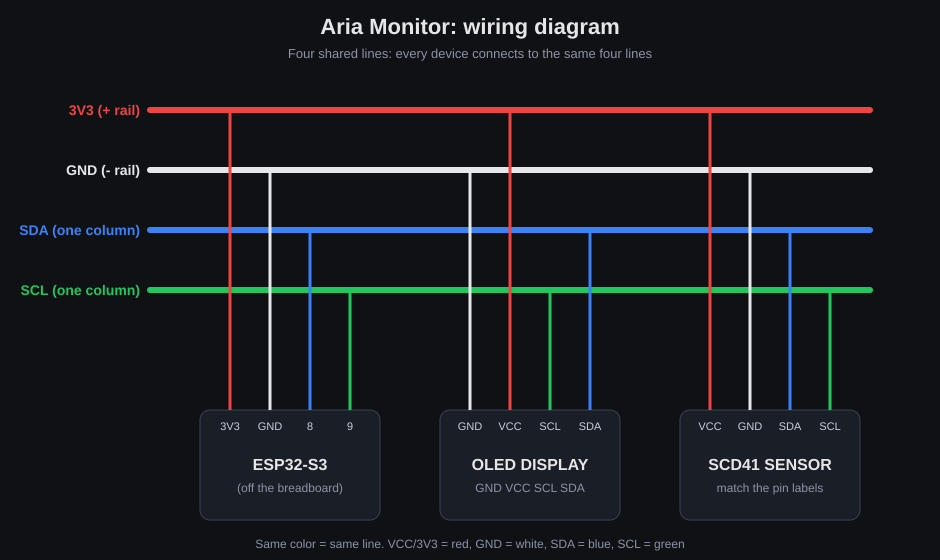

# Aria Monitor

An always-on indoor air-quality monitor built on an ESP32-S3 and a Sensirion SCD41 CO2 sensor, written in MicroPython.

[](LICENSE)
[](https://micropython.org/)
[](https://www.espressif.com/en/products/socs/esp32-s3)



## Table of Contents

- [Overview](#overview)
- [Features](#features)
- [How It Works](#how-it-works)
- [Hardware](#hardware)
- [Getting Started](#getting-started)
- [Usage](#usage)
- [Configuration](#configuration)
- [Project Structure](#project-structure)
- [Troubleshooting](#troubleshooting)
- [Security Notes](#security-notes)
- [Roadmap](#roadmap)
- [Contributing](#contributing)
- [License](#license)

## Overview

Aria Monitor measures CO2, temperature and relative humidity, shows the readings on a small OLED screen, serves a responsive web dashboard on the local network, and sends an email when a room needs ventilating.

**Why CO2?** In a closed room, CO2 rises with every breath. Outdoor air sits around 420 ppm; above roughly 1000 ppm many people notice drowsiness and reduced concentration. CO2 is a convenient proxy for "this room is not being ventilated", so a live reading makes it obvious when to open a window.

**Background.** My day-to-day work is software. This is my first hardware and embedded project: my first time with microcontrollers, I2C buses, breadboards and soldering. I chose something small enough to finish end to end, but useful enough to run every day.

## Features

- OLED display with live CO2, temperature, humidity and a status line
- Mobile-friendly web dashboard: colour-coded CO2, trend sparkline, automatic refresh and a manual refresh button
- JSON endpoint (`/data`) for scripting and integrations
- Email alerts through the [Resend](https://resend.com) API, with hysteresis so each episode triggers a single message
- Optional Home Assistant integration through MQTT auto-discovery
- Optional Telegram notifications
- Static IP support, so the dashboard is always at the same address
- Configurable temperature offset to compensate for the sensor's self-heating
- Test mode: runs without the sensor attached, so Wi-Fi, display and dashboard can be verified first

## How It Works

```
   +----------+   I2C   +-----------------+   Wi-Fi   +--------------------+
   |  SCD41   |-------->|                 |---------->| Browser dashboard  |
   |  (CO2,   |         |    ESP32-S3     |  HTTP     | GET /  and /data   |
   |  T, RH)  |         |   MicroPython   |           +--------------------+
   +----------+         |                 |  HTTPS    +--------------------+
   +----------+   I2C   |  main loop:     |---------->| Resend (email)     |
   |  SSD1306 |<--------|  measure,       |           +--------------------+
   |  OLED    |         |  display,       |  MQTT     +--------------------+
   +----------+         |  serve, alert   |---------->| Home Assistant     |
                        +-----------------+           +--------------------+
```

The firmware runs a single cooperative loop. The SCD41 produces a new sample about every 5 seconds; on each sample the loop updates the display and the dashboard state, publishes to MQTT if enabled, and checks the alert threshold. The HTTP server is non-blocking and is polled between measurements, so serving a page never delays a reading. The last 120 samples (about 10 minutes) are kept in memory for the dashboard sparkline.

## Hardware

| Part | Model | Notes |
|---|---|---|
| Microcontroller | ESP32-S3-DevKitC-1 (N16R8, external antenna) | Wi-Fi and BLE, USB-C. The external-antenna variant needs its antenna attached |
| CO2 sensor | Sensirion SCD41 breakout | CO2, temperature and humidity over I2C (`0x62`). The pin header may need soldering |
| Display | 0.96" SSD1306 OLED, 128x64 | I2C (`0x3C`) |
| Prototyping | Solderless breadboard and jumper wires | Used to share the four I2C/power lines between both devices |

### Wiring

Both peripherals share one I2C bus.

| ESP32-S3 | SCD41 | OLED |
|---|---|---|
| `3V3` | `VDD` | `VCC` |
| `GND` | `GND` | `GND` |
| `GPIO8` (SDA) | `SDA` | `SDA` |
| `GPIO9` (SCL) | `SCL` | `SCL` |

Power both modules from 3V3, not 5 V. The I2C pins are defined by `I2C_SDA` and `I2C_SCL` at the top of `firmware/main.py`. Each ESP32 pin exists only once, so the breadboard is used to fan SDA, SCL, 3V3 and GND out to both devices: a jumper brings each signal into one breadboard column, and each device plugs into the same column.

## Getting Started

### Prerequisites

- Python 3 with `pip`
- A USB-C **data** cable (charge-only cables do not work)
- A 2.4 GHz Wi-Fi network (the ESP32 does not support 5 GHz)
- Optional: a [Resend](https://resend.com) account for email alerts

### 1. Install the tooling

```bash
pip install esptool mpremote
```

### 2. Flash MicroPython

Download the `ESP32_GENERIC_S3` image from <https://micropython.org/download/ESP32_GENERIC_S3/> and save it in the project root as `micropython-esp32s3-<version>.bin`. Put the board into download mode (hold **BOOT**, tap **RST**, release **BOOT**), then run:

```bash
./flash.sh
```

When it finishes, tap **RST** once so the board boots into MicroPython.

### 3. Configure

```bash
cp firmware/config.example.py firmware/config.py
```

Edit `firmware/config.py` with your Wi-Fi credentials and, optionally, the email, MQTT and static IP settings. `config.py` is git-ignored, so credentials stay on your machine.

### 4. Deploy

```bash
./deploy.sh
```

This installs `ssd1306`, `umqtt.simple` and `urequests` on the board, uploads the firmware and reboots it.

### 5. Open the dashboard

Follow the boot log to find the device address:

```bash
mpremote repl
```

Then open `http://<device-ip>/` in a browser on the same network.

## Usage

### Display

Four lines: CO2 in ppm, temperature, humidity, and a status string (`Air is good`, `Air getting stale`, `VENTILATE NOW!`). Without a sensor it shows `Awaiting sensor`.

### Dashboard

`GET /` serves a single self-contained page that polls `/data` every 5 seconds. The CO2 value is green below `CO2_WARN`, amber between `CO2_WARN` and `CO2_ALARM`, and red above `CO2_ALARM`.

### HTTP API

`GET /data` returns the latest reading as JSON:

```json
{
  "co2": 623,
  "temp": 22.1,
  "rh": 51.8,
  "status": "Air is good",
  "history": [618, 620, 623],
  "warn": 1000,
  "alarm": 1200
}
```

| Field | Meaning |
|---|---|
| `co2` | CO2 concentration in ppm |
| `temp` | Temperature in degrees Celsius, after the configured offset |
| `rh` | Relative humidity in percent |
| `status` | Human-readable air-quality status |
| `history` | Most recent CO2 samples, oldest first (up to 120) |
| `warn`, `alarm` | Configured thresholds in ppm |

### Alerts

When CO2 reaches `CO2_ALARM`, one email (and one Telegram message, if enabled) is sent. The alert re-arms only after CO2 drops below `CO2_WARN`, so a hovering value does not produce repeated messages. A short notification is also sent when the device comes online.

### Home Assistant

With `MQTT_ENABLED = True`, the device publishes MQTT discovery messages under `homeassistant/sensor/<device_id>_<key>/config` and appears automatically as a device with three entities: CO2, temperature and humidity. State is published to `aria/<device_id>/state` and availability to `aria/<device_id>/availability`, where `<device_id>` is `DEVICE_NAME` with dashes replaced by underscores. A Mosquitto broker (for example the Home Assistant add-on) is required.

## Configuration

All settings live in `firmware/config.py` (see `firmware/config.example.py` for a full template).

| Setting | Description |
|---|---|
| `WIFI_SSID`, `WIFI_PASSWORD` | Wi-Fi credentials |
| `DEVICE_NAME` | DHCP hostname and MQTT identifier |
| `CO2_WARN`, `CO2_ALARM` | Amber and red thresholds in ppm; the alert fires at `CO2_ALARM` |
| `MEASURE_INTERVAL` | Seconds between samples (the SCD41 produces one about every 5 s) |
| `ALTITUDE_M` | Altitude in metres, used by the sensor for pressure compensation |
| `TEMP_OFFSET_C` | Temperature offset; raise it if the reading is too warm (sensor default is 4.0) |
| `USE_STATIC_IP`, `STATIC_IP`, `SUBNET`, `GATEWAY`, `DNS` | Fixed address for the dashboard |
| `EMAIL_ENABLED`, `RESEND_API_KEY`, `EMAIL_FROM`, `EMAIL_TO` | Email alerts |
| `MQTT_ENABLED`, `MQTT_HOST`, `MQTT_PORT`, `MQTT_USER`, `MQTT_PASSWORD` | Home Assistant integration |
| `TELEGRAM_ENABLED`, `TELEGRAM_BOT_TOKEN`, `TELEGRAM_CHAT_ID` | Telegram alerts |

With the default `onboarding@resend.dev` sender, Resend only delivers to the email address of your own Resend account. To send to other recipients, verify a domain and set `EMAIL_FROM` accordingly.

## Project Structure

```
.
|-- firmware/
|   |-- boot.py              runs at startup
|   |-- main.py              main loop: measure, display, serve, publish, alert
|   |-- config.example.py    settings template (copy to config.py)
|   |-- scd41.py             SCD41 driver: I2C commands, CRC-8 checks, altitude and temperature offset
|   |-- display.py           SSD1306 OLED wrapper
|   |-- wifi.py              Wi-Fi connection with optional static IP
|   |-- webserver.py         non-blocking HTTP server: dashboard and /data
|   |-- mqtt_ha.py           Home Assistant MQTT discovery
|   |-- email_alert.py       email alerts through Resend
|   `-- telegram.py          Telegram alerts
|-- flash.sh                 flashes MicroPython onto the board
|-- deploy.sh                installs libraries and uploads the firmware
|-- wiring-diagram.svg       wiring overview
|-- CONTRIBUTING.md
`-- LICENSE
```

## Troubleshooting

**`mpremote` cannot connect ("could not enter raw repl").** On the ESP32-S3's native USB port the board does not always reset cleanly after flashing. Tap **RST** once and retry.

**`esptool` fails to connect.** Put the board into download mode: hold **BOOT**, tap **RST**, release **BOOT**, then run `./flash.sh` again. If a demo program is running, this also stops it.

**`i2c.scan()` shows nothing, or only one device.** A healthy setup returns `[60, 98]` (OLED at `0x3C`, SCD41 at `0x62`). Check wiring, make sure VCC is on 3V3, and re-inspect the solder joints on the sensor header.

**Wi-Fi connects but the signal is weak.** The `-1U` module variants have no on-board antenna. Attach the external antenna to the u.FL connector with a firm, straight press until it clicks.

**The dashboard shows `--` and the browser console reports `refresh is not defined`.** The page was truncated while being sent. This was fixed by sending the response in a loop until every byte is written, with a `Content-Length` header; make sure you are running the current `webserver.py` and do a hard refresh.

**The dashboard stopped loading.** If you use DHCP, the address may have changed. Check the boot log, or set a static IP in `config.py`.

**Temperature reads a few degrees high.** The sensor warms itself and the board around it. Increase `TEMP_OFFSET_C` and compare against a trusted thermometer.

## Security Notes

- The dashboard and `/data` have no authentication. Keep the device on a trusted local network and do not expose it to the internet.
- `config.py` stores credentials in plain text on the device and is git-ignored. Do not commit it.
- Use a Resend API key restricted to sending access.

## Roadmap

- [ ] Persistent history (flash file or InfluxDB with Grafana)
- [ ] Outdoor forced recalibration of the CO2 sensor (about 420 ppm)
- [ ] Authentication or token for the dashboard
- [ ] 3D-printed enclosure
- [ ] Battery operation with deep sleep

## Contributing

Issues and pull requests are welcome. See [CONTRIBUTING.md](CONTRIBUTING.md) for guidelines.

## License

Released under the [MIT License](LICENSE).
